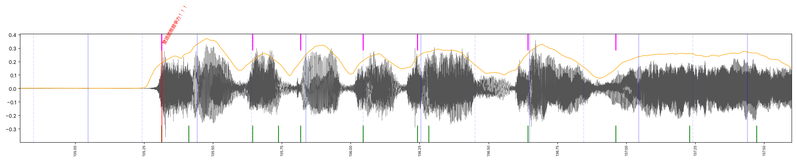

# 4. Waveform 校正：人聲分離 → Onset → 音節 → Snap

這是整個專案**最關鍵**的一步。Whisper 給的是大概位置，waveform 給的才是真正的位置。

## 4.1 先做人聲分離（Demucs）
```bash
pip install torch torchaudio --index-url https://download.pytorch.org/whl/cpu
pip install demucs
python3 -m demucs --two-stems=vocals -n htdemucs song.mp3   # CPU 跑 3:46 的歌約 2.5 分鐘
```
效果：
- 在人聲軌上跑 Whisper，字的邊界準很多，還聽出了歌詞表沒寫的重複 chant。
- 人聲軌的 onset 不會被鼓和貝斯污染。**完整混音上的 onset 幾乎都是鼓。**

## 4.2 Onset：找「聲音開始被聽見」的那一點
```python
o  = librosa.onset.onset_strength(y=vocals, sr=22050, hop_length=128, aggregate=np.median, fmax=6000)
on = librosa.onset.onset_detect(onset_envelope=o, sr=sr, hop_length=128, backtrack=True,
                                units='time', delta=0.04, wait=4)
# 只保留後 80 ms 內真的有聲音的 onset（RMS > 0.06）
```
- `hop_length=128`（約 5.8 ms 解析度）：預設的 512 對於 kinetic type 太粗。
- **`backtrack=True` 很重要**：它會把 onset 退回能量開始上升的位置，也就是耳朵開始聽到的地方，而不是峰值。
- 問題：onset 太密，一個音節常有 2–3 個（子音一個、母音一個）。

## 4.3 音節偵測：包絡谷值法
onset 太碎，所以另外做一個「音節」偵測器：
```python
es = uniform_filter1d(env100, 5)          # 10 ms 解析度的人聲 RMS，再平滑
for k in argrelmin(es, order=4)[0]:        # 找谷值
    peak = es[k:k+18].max()
    if peak > 0.08 and peak > es[k]*1.35 + 0.02:     # 後面要有明顯上升
        attack = 從谷值往峰值，第一個升到 30% 的點
```
**驗證**：雙語國際競爭力七個字，這個方法算出 135.26 / 135.63 / 135.82 / 136.03 / 136.23 / 136.61 / 136.96，和人眼看 waveform 判讀的結果差不到 30 ms。兩個獨立方法吻合，就可以放心了。



## 4.4 合併與去重
`ALL = onsets ∪ syllables`，兩點相距小於 45 ms 就合併成一點。

## 4.5 Snap 規則（tools/align_v2.py）
1. **英文字**：Whisper 的時間 → 吸附到 `[t-0.16, t+0.12]` 內最近的 onset。窗口是不對稱的，因為 Whisper 通常偏晚，所以前面的候選距離乘 0.8 給一點偏好。
2. **靜音規則**：如果字的起點那裡人聲 RMS < 0.05，就往後找 0.6 s 內第一個有聲的 attack。這條修好了 "Welcome" 提早 0.37 s 的問題。
3. **夾在英文中間的中文**：下界用**前一個字的結束時間**，不要用開始時間。這條修好了「中文 handles」被擠到一起的問題。
4. **中文逐字**：一個 n 字的詞需要 n 個 attack。
   - 先用 greedy：從上一個字之後找「下一個音節」，要求間距 > 0.1 s 且 < 0.45 s。
   - 如果超出了下一個字的時間，改用 **DP：在詞的時間範圍內剛好挑 n−1 個 attack**，讓它們最接近均分位置。
5. **單調性**：後一個字至少比前一個字晚 50 ms。
6. **人工確認過的少數修正**寫在 `WIN` / `CHARS` / `TOK` 字典裡，每一筆都有對應的 waveform 圖可以佐證。

## 4.6 為什麼不全部 snap 到 beat grid？
試過「吸到八分音符格線」，結果反而更不準。歌手會搶拍和拖拍，而觀眾對齊的是**聲音**，不是節拍器。beat grid 只拿來 sanity check：中文字間距應該接近 0.197 s 的倍數。
