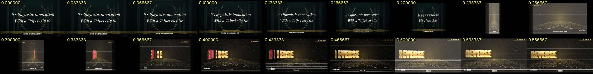

# 7. 轉場，以及「卡卡的」問題

## 每個段落一種主轉場
| 段落 | 鏡頭退場 | 段落邊界 |
|---|---|---|
| 記者會 | whip pan（5 層殘影） | flash |
| 頒獎 glam | zoom-through | flash |
| 副歌 | Y 軸翻轉 | **360° 鏡像旋轉，加上 REWIND 錄影帶效果** |
| 學院 | 金色 wipe | flash |
| 警報 | glitch 碎裂 | glitch 切片 |

## 案例：1:45 和 2:48 為什麼「卡卡的」
使用者回報：「1:45 卡卡的，2:48 也是，都發生在準備進入 reverse jing jing 時」。

**原因有三個，疊在一起：**
1. **歌詞表少了重複的 chant**：實際上「Reverse Jing Jing」唱了兩次，第一次（104.7 s）沒有對應的鏡頭，所以上一個 shot 還掛在畫面上，副歌其實已經開始了。這是**內容和聲音不同步**。
2. **轉場本身**：舊版的鏡像轉場用的是 `cos(2πp)` 在 0.42 s 內轉一圈，畫面寬度兩次縮到接近 0，看起來就像掉幀。
3. **背景鏡頭速度突然改變**：verse 260 → chorus 900 u/s 是瞬間切換，背景會突然一頓。

**修法：**
1. 把漏掉的 chant 加回歌詞表，給它自己的鏡頭。
2. 改成**單次 eased 360° 旋轉，加水平動態模糊殘影**，而且讓旋轉**剛好在副歌第一個音節 "Re-" 落地**。
3. **切點放在旋轉的側面那一幀**：360° 轉一圈的中點是背面，不是側面。用 `inOut(q) = 0.25` 反解出 q ≈ 0.397，在那一幀切掉舊 shot、換上新背景。新的 shot 會以鏡像轉進來，再翻正，剛好呼應 REVERSE 這個概念。

   
4. 鏡頭速度改成用 ±0.8 s 的滑動平均做平滑。

## 一般原則
- 段落邊界要對在**聲音事件**上（第一個音節），不是對在拍點或歌詞表的時間。
- 轉場的「切點」要放在畫面資訊最少的那一幀：側面、全白閃、模糊最重的時候。
- 舊 shot 和新 shot 重疊的時間要短。兩邊同時都看得清楚，就會覺得亂。
