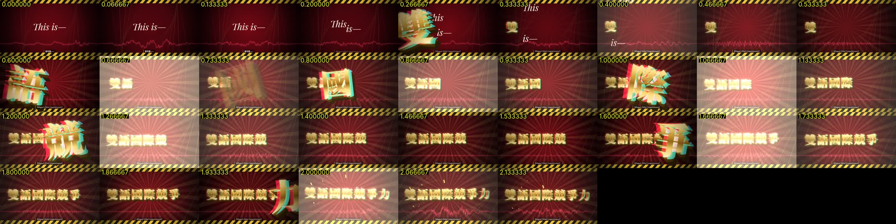

# 9. 驗證：看圖，不要用猜的

## 對齊圖（tools/plot_align.py）
```bash
python3 tools/plot_align.py vocals.wav 133.5 139 out/check.png
```
一張圖畫出：人聲 waveform（灰）、RMS 包絡（橘）、拍點（藍實線）、八分音符格線（藍虛線）、onset（綠，底部）、字的時間（紅，帶標籤）、中文逐字 attack（洋紅，頂部）。
**每一段都要看過。** 6 張一組拼起來，3 張圖就能看完整首歌。

用圖抓到的錯：
- "Welcome" 落在靜音裡（→ 加靜音規則）
- 節能的「能」被推到下一個 attack（→ 音節偵測 + greedy 找下一個音節）
- 中文救場的字溢到 "really" 上面（→ DP fallback）
- outro 的 "Bilingual" 晚了 0.9 s（→ 人工 TOK 修正）
- 3:16 的 chant，"Re-" 實際在 196.15（→ 修 WIN）

## 逐幀 strip（ffmpeg）
```bash
node render.js --from 135.0 --to 137.2 --out t.mp4
ffmpeg -i t.mp4 -vf "select='not(mod(n\,2))',scale=320:180,drawtext=text='%{pts\:flt}':x=6:y=6:fontsize=20:fontcolor=yellow,tile=9x4" -frames:v 1 strip.jpg
```
把每一幀的時間印在畫面上，直接和 attack 的時間比對。雙語國際競爭力每個字都在 attack 的 ±1 幀內落地。


- 坑：在 `select` 之後，`drawtext` 的 `n` 是**被選中的幀**的序號，不是原始幀號。要用 `%{pts}`。

## Contact sheet
挑 15–20 個關鍵時間點出 still，拼成 3×5 的 grid，一眼就能檢查版面、字體 tofu、元素重疊。這次就是這樣抓到的：
- Anton 字體沒有 CJK 字形 → 「頭條」變成豆腐方塊
- ridgeline 投影參數錯了 → 尖刺衝到畫面頂端
