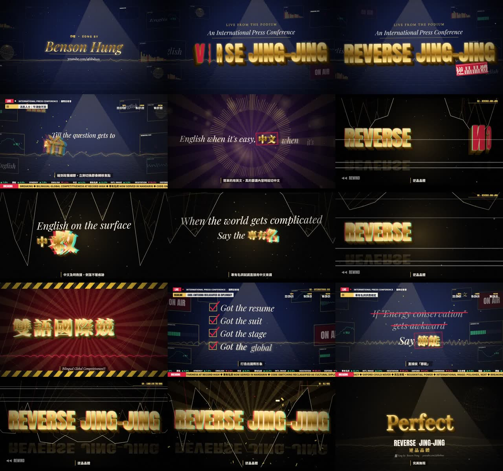

# Lyric Kinetic Motion Graphic: 從「有歌詞、有音樂」到拍點精準的 kinetic typography

這個 wiki 整理了做 **REVERSE JING-JING（逆晶晶體）**（作者 [Benson Hung](https://www.youtube.com/@hbshun)）lyric film 的完整方法論，以及一路踩過的坑。
目標只有一個：**字出現的那一刻 = 聲音出現的那一刻**，在這個前提上再把動態做得有感覺、做得酷。

> 一句話總結：**不要相信任何單一來源的時間。** Whisper、歌詞表、節拍偵測都會騙你。真正可靠的只有分離出來的人聲 waveform。每個時間點最後都要用眼睛對著 waveform 驗過。

## 目錄
1. [[Pipeline 總覽|1-Pipeline-總覽]]：整條流水線與每一步的輸入、輸出
2. [[歌曲分析|2-歌曲分析-Beat-能量-頻譜]]：BPM、beat grid、能量、頻譜，以及哪些數據會用在畫面上
3. [[Whisper 對齊|3-Whisper-對齊]]：怎麼用 Whisper，以及它不可信的地方
4. [[Waveform 校正|4-Waveform-校正-人聲分離-Onset-音節]]：人聲分離、onset、音節偵測、snap 規則（**最關鍵的一頁**）
5. [[讓拍點「有感覺」|5-讓拍點有感覺-動態時間設計]]：視覺 impact 要放在哪一幀
6. [[Motion Design 語彙|6-Motion-Design-語彙與分鏡]]：分鏡、兩套動態語彙、3D 假透視
7. [[轉場|7-轉場-與-卡頓]]：轉場設計，以及「卡卡的」問題怎麼來、怎麼修
8. [[Audio-reactive 背景|8-Audio-Reactive-Waveform-背景]]：用真實頻譜和波形驅動的背景
9. [[驗證|9-驗證-看圖不要用猜的]]：對齊圖、逐幀 strip、contact sheet
10. [[渲染與發佈|10-渲染與發佈]]：deterministic renderer、平行渲染、CI release
11. [[Hard-won Lessons|11-Hard-won-Lessons-清單]]：踩坑清單，下次開工前先讀
